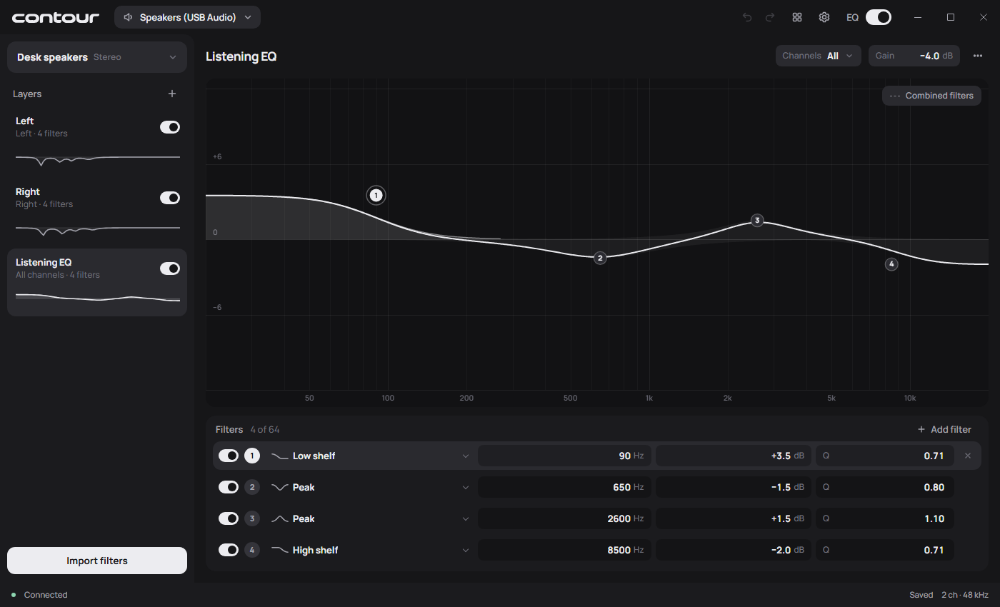

<div align="center">
  <picture>
    <source media="(prefers-color-scheme: dark)" srcset=".github/images/wordmark-dark.svg">
    
  </picture>


Contour is a system wide parametric equalizer for Windows.


Build an EQ from layers, choose which channels each layer affects, and edit filters directly on the graph. Import filters from REW, make adjustments by ear, or combine both in the same profile.




</div>

## Layers

Each layer has its own parametric filters, gain, and channel selection. Apply it to one channel, any combination of channels, or all channels. Layers stay visible alongside the editor and can be enabled, disabled, and reordered independently.

For example, separate left and right layers can hold room correction filters, with another layer applying a tonal adjustment to both. The same approach works for channel groups in a multichannel setup.

## Equalizer

Drag filter points on the graph or enter frequency, gain, and Q directly. Changes are previewed live, with individual filter curves and a combined response view.

Eight filter types are supported: peak, low shelf, high shelf, low pass, high pass, notch, all pass, and band pass. Individual filters can be bypassed without removing them.

REW and Equalizer APO parametric filter text can be imported from a file or pasted into the editor. Layers can also be exported as filter text. Import supports parametric filters rather than complete Equalizer APO configurations; routing commands, convolution, and unsupported filter definitions aren't imported.

Contour applies EQ. Measurements and correction filter generation are handled separately in tools such as REW.

## Profiles

A profile stores the layers, filters, and channel assignments for an EQ. Profiles can be duplicated, renamed, and imported or exported as `.contour` files.

The same profile can be assigned to multiple compatible outputs. Saving changes updates every device using it; duplicate the profile when separate settings are needed. For a different channel count, **Adapt a copy** lets you review the channel assignments before using it.

The global EQ switch applies across devices and is independent of profile saving.

## Devices and tray

Contour can be installed on multiple output devices, each with its own profile assignment. **Settings → Outputs** lists devices, their installation state, and compatibility status.

Audio processing uses Contour's own native engine, installed as a Windows Audio Processing Object (APO).

Saved EQ continues to run when the app is closed. The tray provides access to outputs, profiles, layers, and the global EQ switch. Contour can start with Windows, open in the tray, and keep running there when its window is closed.

## Download and installation

Contour requires **Windows 11, x64**.

Download the Windows x64 installer from [Releases](https://github.com/Boof2015/contour/releases).

Install Contour on each output that should receive EQ. Installing the app alone does not enable audio processing. Device installation, removal, and engine updates require administrator approval and briefly interrupt Windows audio.

The installer handles the Visual C++ and WebView2 runtimes if needed. Installing a missing WebView2 runtime requires an internet connection.

### Unsigned builds

Contour is currently unsigned, so Windows may display an unknown-publisher warning.

Device installation enables the Windows setting that allows unsigned audio effects, if needed. This affects all audio devices and may affect protected media playback, though usually unlikely. Contour records the previous setting and leaves it enabled after removal if enabled before its installation to preserve compatibility with other audio software that relies on it.

## Compatibility

Contour processes playback through the Windows shared audio engine. Applications using [ASIO or WASAPI exclusive mode bypass that engine](https://learn.microsoft.com/en-us/windows-hardware/drivers/audio/low-latency-audio#windows-audio-stack). If an application's audio isn't being equalized, check that it uses a shared Windows output.

Device support depends on the audio driver and its existing effects. Compatibility results are shown in **Settings → Outputs**. Testing across more hardware is ongoing.

## Updates and removal

Run a newer installer to update the app. Existing profiles and device installations are kept.

To remove Contour from one device, use **Settings → Outputs → Manage → Uninstall**.

To remove the application and its device installations, uninstall Contour through Windows **Installed apps**. Profiles and preferences are kept by default; select **Delete saved profiles and settings** during uninstall to remove them too.

## Support

If you find Contour useful and want to support a broke college student, consider supporting development:

[](https://ko-fi.com/boof2015)

## Building from source

Build on Windows 11 x64 with:

- Git and CMake 3.24 or newer
- Visual Studio 2022 or its Build Tools, with **Desktop development with C++** and **Windows SDK 10.0.26100.0**
- Microsoft Edge WebView2 Runtime to run the app

Clone the repository and build:

```powershell
git clone https://github.com/Boof2015/contour.git
cd contour
cmake --preset windows-x64
cmake --build --preset windows-x64-release
```

CMake downloads the required dependencies during configuration. Run the app from the build directory:

```powershell
.\build\windows-x64\bin\Release\contour.exe
```

Keep the accompanying files alongside the executable. To enable EQ on a device, use **Settings → Outputs** as described above.

<details>
<summary>Running tests</summary>

Install Node.js 24 and Microsoft Edge before configuring the build to include the UI tests. After building, run:

```powershell
ctest --preset windows-x64-release
```

The automated tests do not install Contour on audio devices or play sound.

</details>

<details>
<summary>Building the installer</summary>

To build a local installer, also install **MSVC 14.44**, **Ninja**, **Node.js 24**, and **Microsoft Edge**, then run from the repository root:

```powershell
powershell.exe -NoProfile -ExecutionPolicy RemoteSigned -File tools/ci/build.ps1 -Installer
```

The script builds Contour, runs the automated tests, and downloads the required packaging tools. The installer is written to `build/ci/distribution/installer/`.

</details>

## License

Contour is licensed under [GPL-3.0-only](LICENSE). Bundled third-party components retain their own licenses, available in **Settings → Info**.
